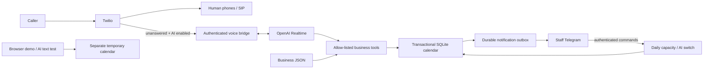

# Architecture and lineage

## What came from each project

- **Kspa / Kiki:** human-first routing, SIP plus mobile ringing, per-caller AI exclusions, persisted fallback switch, truthful booking confirmations, a separate callback path, and the source for a Smiley integration with readback.
- **Footprint / Karin:** direct answers before booking questions, shared capacity/party-size checks, practical Telegram staff administration, and isolated conversation tests.
- **Shared v0.1 core:** a new configuration boundary and local calendar that avoids hardcoding either store's identity, staffing or service vocabulary. `ToolSession` is the boundary between conversation providers and business actions.

The source snapshots in `reference/` preserve both implementations for readers studying the integrations. The generic app **does not import or execute them**. Private configuration, customer databases, historical handoffs, call logs, personal phone exclusions, group identifiers, voice models, recordings, credentials and original Git history are excluded. Historical store-specific tests were omitted because they embedded real identifiers and do not validate the new core.

## Consistency

A proposal does not reserve inventory. Confirmation takes an immediate write transaction, verifies that the proposal belongs to the current call, rechecks real availability and atomically writes the booking and notification. A repeated confirmation token returns the original booking. A proposal expires after five minutes. Prepared details are stored server-side; callers cannot alter a confirmed proposal by changing a tool argument.

Capacity is evaluated at the peak number of overlapping occupied units, including service buffers. Adjacent reservations do not overlap. Reducing capacity never silently deletes a customer's booking.

The model is still responsible for conversational interpretation and obtaining a genuine verbal confirmation. A boolean tool argument is not a cryptographic proof of customer consent. Tests verify the server's required proposal/confirmation sequence; operators should evaluate real conversations before launch.

## Extension points

For a new scheduling backend, replace the calendar operations used by `ToolSession` and keep their contracts: authoritative availability, atomic/rechecked writes, idempotent confirmation, no success before verified persistence, and explicit uncertainty on remote failure. Preserve customer confirmation and staff escalation.

For named staff or equipment, implement qualified resource assignment rather than claiming that the scalar capacity field can express those constraints. For a new AI provider, adapt `realtime.py` while reusing the same tools and tests. No provider migration has been validated in this release.

The OpenAI transport follows the official [Realtime conversation events](https://developers.openai.com/api/docs/guides/realtime-conversations) and [client event reference](https://developers.openai.com/api/reference/resources/realtime/client-events), consulted on October 8, 2026. It sends PCMU audio on phone calls and waits for all function outputs before continuing a response.
